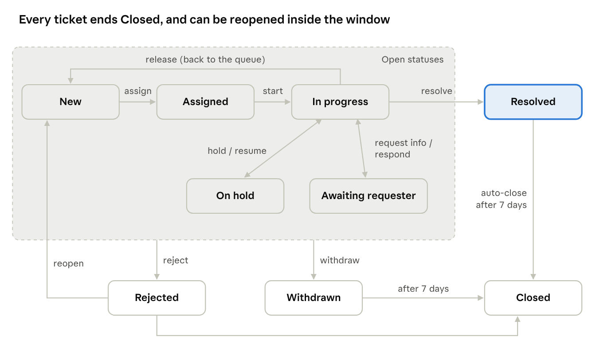

# Service Desk Platform: Requirements

23 November 2026 · Sarthak. Editable copy: https://claude.ai/artifact/3TuDWe4wTurjBqM8NexaJr

## Purpose and scope

The platform lets internal staff and client customers raise support tickets, routes them to the right team and person, and holds every ticket to a service level measured in working time. It serves one internal organisation and any number of client organisations from a single installation.

**In scope**

- Accounts, sign-in, sessions and API tokens for members and product users (end customers of a client).
- Organisations, projects, teams and role assignments, with every rule scoped to the project.
- Ticket intake from the portal and the REST API, manual and automatic routing on people's shifts.
- A nine-status lifecycle with 15 actions, plus priority and estimate changes.
- SLA policies with timed steps, working-time calendars, pauses, extensions and breach detection.
- Escalation rules that notify, reassign or raise priority.
- Notifications in-app, by email (SMTP) and by chat webhook, with editable templates.
- Lists, team boards, a dashboard, system status, typed settings and a configuration audit log.

**Out of scope for this release**

- Custom ticket fields, attachments, knowledge base and customer satisfaction surveys.
- Inbound email (raising a ticket by sending an email).
- Single sign-on (SAML or OIDC) and multi-language interface.
- Structured JSON logs and a metrics endpoint (deferred, see open items).

## Users and roles

Rights come from role assignments, each scoped to a team, a project or an organisation; a person's rights on a ticket are the union of every assignment that matches it. Anyone may hold several roles in several projects.

| Role | Scope | Can do |
| --- | --- | --- |
| Platform admin | Whole installation | Everything: organisations, calendars, priorities, statuses, channels, templates, global settings; grants platform admin |
| Organisation admin | One organisation | Administer every project of that organisation and grant roles inside it |
| Project admin | One project | Teams, ticket types, SLA policies, escalation rules, project settings, API credentials, role grants in the project; assign, reassign, release, priority, estimate and SLA actions on its tickets |
| Team manager | One team | Assign, reassign, change priority and estimate, pause, resume or extend SLA, release; sees the team board |
| Resolver | One team, with an optional shift calendar | Claim from the queue, start, hold, request information, resume, resolve, reject; works own tickets |
| Requester (member) | Projects they may raise in | Raise tickets, answer questions, withdraw, reopen inside the window; sees public history only |
| Product user | One client project | A client's end customer: raises and follows own tickets through the portal or the API, if the project allows it |

Accounts are created by an administrator; there is no self sign-up. A requester never sees SLA timers, estimates, effort or internal notes.

## Functional requirements

Twelve feature areas, F1 to F12; each requirement below is built and covered by tests (see [TRACEABILITY.md](../TRACEABILITY.md)).

| ID | Area | Requirement |
| --- | --- | --- |
| F1 | Accounts and sign-in | Administrator creates accounts with a temporary password shown once; the user must change it at first sign-in. Email and password sign-in with one message for unknown email or wrong password. Lock after 5 failed attempts for 15 minutes. Minimum password length 10, not equal to the email or the current password. Portal sessions end after 30 minutes idle or 12 hours. API tokens last 60 minutes. Deactivation ends every session and token at once. |
| F2 | Structure | Organisations (internal or client), projects with a unique key locked after the first ticket, teams, role assignments, bulk add with a per-person outcome. Project API credentials with a secret shown once and revocable. Records are deactivated, never deleted; a team with open tickets cannot be deactivated. |
| F3 | Intake | Raise a ticket with project, type, title (1 to 200 characters), description (up to 10,000) and optional priority. Numbered KEY-n per project. Repeated Idempotency-Key with the same body returns the original ticket. The requester gets an acknowledgement. |
| F4 | Routing | Each ticket type routes to one team, manually or automatically. Automatic routing picks an on-shift resolver with the fewest open tickets, then the one idle longest. With nobody on shift the ticket waits, is retried every 5 minutes and can be claimed; of ten concurrent claims exactly one wins. Release skips the releasing resolver once. |
| F5 | Lifecycle | Nine statuses and 15 actions (next section). Notes are required on hold, request information, respond, resolve, reject, withdraw, reassign and reopen. Actions lock the ticket row; screen and API give identical permission outcomes. |
| F6 | SLA | Policies match on priority and optionally ticket type; a type policy beats the default. Each policy has cumulative steps (for example Assignment, First response, Resolution), each stopped by reaching a status. Timers run in working time on the policy calendar, pause in On hold and Awaiting requester, and record a breach once. Managers can pause, resume and extend. A priority change replaces timers from the original start; met steps stay met. Resolution time is stored in working minutes. |
| F7 | Escalation | Rules on an SLA step fire at a percent used or on breach, once per ticket, level and reopen cycle. Actions: notify team managers, project admins, a user or a team; reassign; increase priority. Every firing appears in the ticket history. |
| F8 | Notifications | Ten notification types. In-app is always on, with an unread count on the bell. Email (SMTP) and chat webhook channels are optional, configured by an administrator; templates with placeholders and preview. Delivery happens after commit through an outbox, retried with back-off 1, 2, 4 ... 60 minutes up to 5 attempts; a failed channel never blocks a ticket. |
| F9 | Product users | A client project can let its customers use the API (project key, secret and external user id) and or the portal; at least one stays on. Product users see only their own tickets. Whether they may set priority is a project setting. |
| F10 | Lists and dashboards | My tickets, My work, Team queue, Team board and All tickets, with filters (status, priority, resolver, overdue, dates, search), sorting and paging. Sidebar counts. Admin dashboard of open, at-risk and breached tickets by team, and a system status page (worker heartbeat, failed sends, job backlog). |
| F11 | Settings | A typed registry of 17 settings, global or per project, validated with ranges, hot reloaded, every change audited. Reopen window must not exceed the auto-close delay. |
| F12 | Audit | Every configuration change records who, when, what and the before and after values, scoped so a project admin sees only their projects. |

## Ticket lifecycle

A ticket moves through nine statuses; five are open, three finish it, and Closed is final. Every finished ticket closes on its own after the auto-close delay (7 days by default).

Assignment happens by a manager, by a resolver's claim or automatically. Hold, request information and resolve are also allowed straight from Assigned. Reject works from any open status; withdraw (by the requester) from New, Assigned, On hold and Awaiting requester. Reopen returns any finished ticket to New inside the reopen window, except after a Wrong team or Duplicate rejection. A requester who does not answer within 7 days is rejected by the system with reason No reply. Priority, estimate and SLA pause, resume and extend do not change the status.

## Non-functional requirements

| Area | Requirement | Status |
| --- | --- | --- |
| Security | Passwords hashed with Argon2. Tokens and credential secrets stored only as SHA-256 of long random values, shown once. Channel secrets referenced by environment-variable name, never stored. CSRF tokens on every portal form. | Met |
| Privacy of scope | A record outside the caller's scope answers 404, never 403; permission is checked before input is validated. | Met |
| Consistency | One transaction per request or action; lifecycle actions lock the ticket row; external delivery only after commit. | Met |
| Time | All times stored in UTC through one injectable clock; working time computed only by the working-time engine (17 worked examples tested). Display in the team's time zone. | Met |
| Configuration | Statuses, priorities, types, policies, rules, channels and templates are data, not code. Nine core statuses are locked (rename only). | Met |
| Background work | Database-backed jobs with SKIP LOCKED, at least once, idempotent handlers; no message broker. | Met |
| Performance: worker | One cycle at 10,200 open SLA timers in 5 seconds or less. | Met (4.5 to 5 s) |
| Performance: concurrency | Ten simultaneous claims on one ticket give exactly one winner. | Met |
| Performance: latency | Pages and API actions fast at 100 concurrent users. | Met to about 25 users on a laptop; not met at 100 |
| Accessibility | Every form control labelled; status and SLA never shown by colour alone; keyboard-only use; native dialogs keep focus. | Automated checks met; manual pass open |
| Operations | Health endpoint, system status page, repeatable seed, Alembic migrations, backup and restore drill with pg_dump. | Met; structured logs and metrics not built |
| Interface | Clean, professional portal with light and dark themes and a sidebar layout usable at phone width. | Met |

## Interfaces

- **REST API** at /api/v1 with an OpenAPI page at /api/docs: 109 endpoints. Staff use a bearer token; client products use project key, secret and external user id. Errors have one shape: error code, message and per-field messages.
- **Portal and admin portal**: 30 server-rendered screens using the same service functions as the API, so both always agree on who may do what. Works without JavaScript; dialogs and the bell use one small script.
- **Notification channels**: email over SMTP (host, port, sender, user, password variable, STARTTLS) and chat webhooks posting JSON text to a URL held in an environment variable.
- **Background worker**: one process running due jobs, SLA breach and warning sweeps, escalation, auto-close, no-reply rejection, routing retry and outbox delivery.
- **Database**: PostgreSQL 17, 29 tables, migrations with Alembic.

## Acceptance, open items and known limits

The release is accepted when every function F1 to F12 has a passing test, every endpoint has a role-denial test, and screen and API give the same permission outcome. Today all 355 tests pass on PostgreSQL.

**Open items**

- [ ] Confirm the 25 decisions still marked Proposed in [DECISIONS.md](../DECISIONS.md) (7 of 32 are confirmed).
- [ ] Meet page and API latency at 100 concurrent users on a production-like host: more workers and profiling of the list view.
- [ ] Build structured JSON logs and a metrics endpoint.
- [ ] Do a manual accessibility pass with a screen reader.
- [ ] Load real configuration: organisations, teams, calendars, holidays, SLA targets and escalation contacts.
- [ ] Set up the email channel with the organisation's SMTP server and send a test.

**Known limits**

- Tickets cannot move between projects or teams; a wrong-team ticket is rejected and raised again.
- Notes are written only with actions; there is no free comment thread on a ticket.
- No custom fields, attachments or inbound email in this release.
